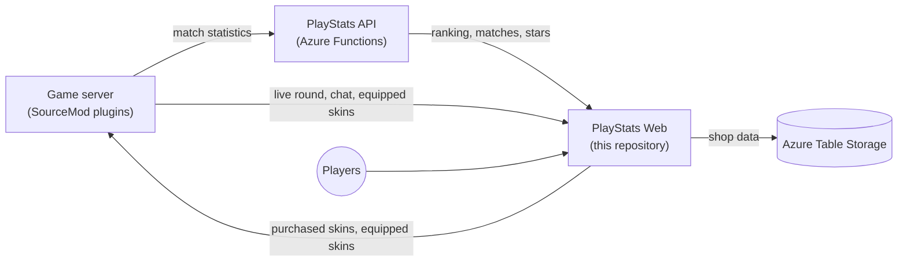

# L4D2 PlayStats Web

🌐 [English](README.md) | [Português](README.pt.md) | **Español**

Ranking, estadísticas y tienda de skins de armas para un servidor competitivo de Left 4 Dead 2. Hecho con ASP.NET Core MVC (.NET 10).

Es el sitio de la comunidad brasileña **[l4d2.com.br](https://l4d2.com.br/)**.

<p align="center">
  
</p>

## Contenido

- [Funciones](#funciones)
- [Cómo encajan las piezas](#cómo-encajan-las-piezas)
- [Capturas de pantalla](#capturas-de-pantalla)
- [Requisitos](#requisitos)
- [Configuración](#configuración)
- [Plugins del servidor de juego](#plugins-del-servidor-de-juego)
- [Ejecución local](#ejecución-local)
- [Despliegue](#despliegue)
- [API usada por el servidor de juego](#api-usada-por-el-servidor-de-juego)
- [Comprobar que funciona](#comprobar-que-funciona)
- [Solución de problemas](#solución-de-problemas)
- [Más documentación](#más-documentación)

## Funciones

**Ranking y estadísticas**

- Ranking construido a partir de las estadísticas de las partidas guardadas por la [PlayStats API](https://github.com/altair-sossai/l4d2-playstats-api). El ranking se reinicia cada dos meses, y los rankings anteriores siguen disponibles en la página de historial.
- Patentes (niveles), la página de detalles de cada jugador y la comparación lado a lado de dos jugadores, incluidas sus estrellas y skins.
- Últimas partidas con marcadores, puntos por mapa, gráficos y detalles de la partida.
- Página del servidor con la ronda en vivo: marcador, jugadores y chat, enviados por el servidor de juego en tiempo real.

**Tienda de skins de armas**

- Los jugadores ganan **1 estrella por MVP** (daño a infectados especiales o infectados comunes) en partidas competitivas, contadas en todo su historial.
- Las estrellas compran skins para 15 armas: SMG, MAC-10, MP5, pump shotgun, chrome shotgun, Magnum y 9 armas cuerpo a cuerpo.
- Hay 196 skins hechas por la comunidad, en cinco rarezas. El catálogo, los precios y los créditos vienen de Steam Workshop.
- Cada skin tiene seis fotos tomadas en el juego con [l4d2-screenshot-studio](https://github.com/altair-sossai/l4d2-screenshot-studio): primera persona, tres en el suelo y dos en tercera persona. Al pasar el ratón sobre una tarjeta se alternan las fotos en primera y tercera persona, y la ventana de detalles muestra las seis con miniaturas y zoom. Las fotos son AVIF (WebP para navegadores antiguos), servidas desde Azure Blob Storage y solo se descargan cuando un jugador pasa el ratón sobre una tarjeta o abre una skin. `shots` en `skins.json` es la versión de las fotos: súbela cuando se rehagan las fotos de una skin, para que los navegadores descarguen los archivos nuevos.
- Las skins compradas duran una temporada del ranking. En cada reinicio del ranking, las compras se reembolsan automáticamente y las estrellas vuelven. Los regalos se conservan para siempre.
- Los jugadores equipan las skins en el sitio o en el juego con `!skin`. El servidor de juego descarga solo las skins que alguien compró.

**Administración** (solo para los SteamIDs de `ServerAdmins`)

- Compras de skins: totales, búsqueda, reembolsos (una compra o todas) y regalos.
- Precios de las skins: cambia un precio sin despliegue.
- Bloqueos del chat del sitio.

**General**

- Inglés, portugués (Brasil) y español, con temas oscuro y claro.
- Diseño responsive. También funciona en el navegador integrado del juego, por eso usa Bootstrap 3.4.1 y jQuery 1.12.4.
- Inicio de sesión con Steam (OpenID), y nombres y avatares de los jugadores desde la Steam Web API.
- Una página de anti-cheat para los jugadores.

## Cómo encajan las piezas



El sitio solo lee de la PlayStats API, salvo dos acciones de admin (castigos y la corrección del marcador de una partida), que necesitan `PlayStatsSecret`. La ronda en vivo, el marcador, los jugadores y el chat que envía el servidor de juego se guardan en memoria, así que quedan vacíos tras un reinicio hasta que el servidor de juego los vuelve a enviar.

| Repositorio | Función |
|---|---|
| [l4d2-playstats-api](https://github.com/altair-sossai/l4d2-playstats-api) | Guarda las estadísticas, arma las partidas y el ranking, y calcula las estrellas |
| [l4d2-zone-server](https://github.com/altair-sossai/l4d2-zone-server) | Configs del servidor de juego y plugins de SourceMod, incluida la [wiki completa de las skins de armas](https://github.com/altair-sossai/l4d2-zone-server/tree/master/docs/weapon-skins) |
| [l4d2-zone-server-assets](https://github.com/altair-sossai/l4d2-zone-server-assets) | Modelos y materiales de las skins (FastDL), con los [créditos de cada autor de skin](https://github.com/altair-sossai/l4d2-zone-server-assets#weapon-skin-credits) |

## Capturas de pantalla

### Ranking

Temas oscuro y claro.

<p align="center">
  
</p>

<p align="center">
  
</p>

### Tienda de skins de armas

La regla de la temporada, cómo ganar y usar las estrellas, y el saldo del jugador.

<p align="center">
  
</p>

El catálogo, agrupado por rareza, con filtros por arma y rareza.

<p align="center">
  
</p>

### Comparación de jugadores

Dos jugadores lado a lado: ranking, estrellas, estadísticas, historial de partidas y skins. El primer jugador se muestra en blanco y el segundo en amarillo.

<p align="center">
  
</p>

### Últimas partidas

<p align="center">
  
</p>

### Patente mostrada en el juego

<p align="center">
  
</p>

> Los avatares de los jugadores están difuminados en estas capturas.

## Requisitos

| Qué | Para qué |
|---|---|
| **.NET 10 SDK** | Compilar y ejecutar. El build de producción es self-contained, así que el host no necesita .NET |
| **[PlayStats API](https://github.com/altair-sossai/l4d2-playstats-api)** | El sitio lee de ella el ranking, las partidas y las estrellas. Usa un despliegue existente o aloja el tuyo. El sitio necesita un servidor registrado allí: `ServerId` es la row key de una fila de la tabla `Servers` de la API, y `PlayStatsSecret` es el `Secret` de esa fila |
| **Cuenta de Azure Storage** (o [Azurite](https://learn.microsoft.com/azure/storage/common/storage-use-azurite) en local) | Solo Table Storage: `SkinShop` (compras, carteras, skins equipadas), `SkinPrices` (precios modificados), `ChatBans` y `PlayerConnectionInfo`. Las tablas se crean en el primer uso |
| **Clave de la Steam Web API** | Nombres y avatares de los jugadores y los detalles del servidor desde la lista de servidores de Steam |
| **Node.js** (solo en local) | Para instalar Azurite con npm |

### Inicio de sesión con Steam y la clave de la Steam Web API

- El inicio de sesión usa Steam OpenID. No necesita clave ni registro. Las rutas son `/login` y `/logout`, y la cookie de sesión dura 30 días.
- La clave de la Steam Web API se crea en [steamcommunity.com/dev/apikey](https://steamcommunity.com/dev/apikey): inicia sesión con Steam, escribe el dominio de tu sitio, acepta los términos y copia la clave.
- `SteamApiKey` acepta varias claves separadas por `;`, `,` o `|`. El sitio las usa por turnos.

## Configuración

`L4D2PlayStats.Web/L4D2PlayStats.Web/appsettings.json` está ignorado por git. Créalo en cada máquina. Los valores de abajo son placeholders; nunca hagas commit de valores reales.

```json
{
  "Logging": {
    "LogLevel": {
      "Default": "Information",
      "Microsoft.AspNetCore": "Warning"
    }
  },
  "Kestrel": {
    "Endpoints": {
      "Http": {
        "Url": "http://*:5000"
      }
    }
  },
  "ServerId": "<server-id>",
  "PlayStatsApiUrl": "https://<playstats-api-host>",
  "PlayStatsSecret": "<server-secret>",
  "SteamApiKey": "<steam-web-api-key>",
  "ServerDns": "<game-server-host>:27015",
  "ServerAdmins": "<steamid64>;<steamid64>",
  "SecretKey": "<long-random-string>",
  "AzureWebJobsStorage": "<storage-connection-string>",
  "AllowedHosts": "*"
}
```

| Clave | Obligatoria | Qué es |
|---|---|---|
| `ServerId` | Sí | El id del servidor registrado en la PlayStats API. Toda petición de ranking, partidas y estrellas lo usa |
| `PlayStatsApiUrl` | Sí | URL base de la PlayStats API, sin `/api`. El sitio no arranca sin ella |
| `PlayStatsSecret` | Solo para acciones de admin | El secret del servidor en la PlayStats API. El sitio envía `Authorization: <ServerId>:<PlayStatsSecret>`. Leer no necesita secret; solo los castigos y la actualización del marcador de una partida lo necesitan |
| `SteamApiKey` | Sí | Clave de la Steam Web API, o varias separadas por `;`, `,` o `\|` |
| `ServerDns` | Sí | Hostname que usan los jugadores para conectarse, por ejemplo `server.example.com` o `host:puerto`. Se muestra como el comando `connect`, `/connect` redirige a `steam://connect/<ip>:<puerto>`, y se resuelve a la dirección del servidor una vez por proceso (puerto 27015 por defecto). Los detalles del servidor vienen de la lista de servidores de Steam, así que el servidor de juego debe aparecer en ella |
| `ServerAdmins` | Sí | SteamID64s de los admins del sitio, separados por `;`, `,` o `\|`. No puede estar vacío: todas las páginas lo comprueban para los usuarios con sesión iniciada |
| `SecretKey` | Sí, para el servidor de juego | Secret compartido que el servidor de juego envía en el header `Authorization`, comparado de forma exacta. Debe coincidir con el `l4d2_web_secret` de los plugins. Usa una cadena larga y aleatoria, por ejemplo de `openssl rand -hex 32` |
| `AzureWebJobsStorage` | Sí | Connection string de Azure Storage. Usa `UseDevelopmentStorage=true` para Azurite |
| `SkinShotsUrl` | No | URL base de las fotos de las skins en el juego. Por defecto es `https://l4d2playstats.blob.core.windows.net/assets/skin-shots` |
| `Kestrel:Endpoints:Http:Url` | No | Dirección y puerto en los que escucha Kestrel. Producción usa `http://*:5000`. Sin ella, el sitio escucha en `http://localhost:5000` |
| `AllowedHosts`, `Logging` | No | Ajustes estándar de ASP.NET Core |

Notas:

- El sitio no arranca sin `appsettings.json` en su directorio de trabajo (la carpeta del proyecto con `dotnet run`, la carpeta de la app en el host). Se carga al final, así que sus valores ganan a las variables de entorno y a los argumentos de línea de comandos.
- `SteamApiKey`, `ServerAdmins` y el `ServerDns` resuelto se leen una vez por proceso. Reinicia el sitio después de cambiarlos.
- `appsettings.json` se copia a la salida del publish cuando existe. Los builds de CI nunca lo tienen, así que un despliegue nunca reemplaza el archivo del host; un `dotnet publish` local sí incluye el tuyo.
- El catálogo de skins (`L4D2PlayStats.Core/Skins/Data/skins.json`) va incrustado en el build, así que un cambio en el catálogo necesita un nuevo build y despliegue. El `id` de cada skin debe coincidir con una skin del `addons/sourcemod/configs/weapon_skins.cfg` del plugin, en l4d2-zone-server. Los precios se pueden cambiar en la página de admin sin despliegue; se guardan en `SkinPrices`.
- Algunos valores son constantes en `L4D2PlayStats.Core/AppConsts.cs`: la URL del sitio usada en los metadatos de las páginas (`https://l4d2.com.br`), la imagen por defecto para compartir, la URL base de la Steam Web API y los enlaces de la página de anti-cheat. Una copia en otro dominio los cambia allí.

## Plugins del servidor de juego

Todos los plugins están en [l4d2-zone-server](https://github.com/altair-sossai/l4d2-zone-server), donde [docs/plugins](https://github.com/altair-sossai/l4d2-zone-server/blob/master/docs/plugins/README.md) documenta cada uno.

| Plugin | Qué hace | Ajustes principales |
|---|---|---|
| `l4d2_playstats` | Escribe las estadísticas de cada mapa | — |
| [`l4d2_playstats_sync`](https://github.com/altair-sossai/l4d2-zone-server/blob/master/addons/sourcemod/scripting/l4d2_playstats_sync.sp) | Sube las estadísticas a la PlayStats API y luego limpia la caché del ranking del sitio en `<l4d2_web_url>/api/cache/clear` | `playstats_url`, `playstats_access_token`, `l4d2_web_url`, `l4d2_web_secret` |
| [`l4d2_ranking`](https://github.com/altair-sossai/l4d2-zone-server/blob/master/addons/sourcemod/scripting/l4d2_ranking.sp) | `!ranking` y el panel del ranking al inicio de una partida | `ranking_url`, `ranking_show_motd_panel` |
| [`l4d2_show_patent_icon`](https://github.com/altair-sossai/l4d2-zone-server/blob/master/addons/sourcemod/scripting/l4d2_show_patent_icon.sp) (opcional) | Muestra la patente de cada jugador sobre su cabeza durante el ready-up | `patent_icon_api_url`, `patent_icon_version`, `patent_icon_max_level`, además de `sv_downloadurl` (FastDL) |
| [`l4d2_gameinfo_sync`](https://github.com/altair-sossai/l4d2-zone-server/blob/master/addons/sourcemod/scripting/l4d2_gameinfo_sync.sp) | Envía la ronda en vivo, el marcador y el chat al sitio, y muestra el chat del sitio en el juego | `l4d2_web_url`, `l4d2_web_secret` |
| [`l4d2_weapon_skins`](https://github.com/altair-sossai/l4d2-zone-server/blob/master/addons/sourcemod/scripting/l4d2_weapon_skins.sp) | Descarga las skins compradas, las aplica y sincroniza las skins equipadas | `weapon_skins_enabled`, `l4d2_web_url`, `l4d2_web_secret`, además de `sv_downloadurl` (FastDL) |

Dónde va cada ajuste en l4d2-zone-server:

| Ajuste | Archivo | Valor |
|---|---|---|
| `l4d2_web_url` | `cfg/server.cfg` | URL del sitio sin barra final, por ejemplo `https://example.com` |
| `l4d2_web_secret` | `cfg/server_secrets.cfg` (ignorado por git, ejecutado por `server.cfg`) | El `SecretKey` del sitio |
| `playstats_access_token` | `cfg/server_secrets.cfg` | `<ServerId>:<PlayStatsSecret>`, el mismo servidor que en los ajustes del sitio |
| `sv_downloadurl` | `cfg/server.cfg` | URL del FastDL que sirve [l4d2-zone-server-assets](https://github.com/altair-sossai/l4d2-zone-server-assets) |
| `playstats_url` | `cfg/cfgogl/<config>/shared_cvars.cfg` | URL base de la PlayStats API |
| `ranking_url` | `cfg/cfgogl/<config>/shared_cvars.cfg` | URL del sitio que se muestra en el panel del ranking |
| `patent_icon_api_url` | `cfg/cfgogl/<config>/shared_cvars.cfg` | URL del sitio |
| `weapon_skins_enabled` | `cfg/cfgogl/<config>/shared_cvars.cfg` | `1`. El plugin viene desactivado por defecto |

Cada config de `cfg/cfgogl/` (por ejemplo `zonemod`, `neomod`) tiene su propio `shared_cvars.cfg`, así que define los valores en cada una que uses.

## Ejecución local

1. Inicia Azurite (`npm install -g azurite`, luego `azurite`). Las tablas se crean en el primer uso.
2. Crea `L4D2PlayStats.Web/L4D2PlayStats.Web/appsettings.json` (ver [Configuración](#configuración)) con:
   - `"AzureWebJobsStorage": "UseDevelopmentStorage=true"`;
   - `PlayStatsApiUrl` y `ServerId` apuntando a una PlayStats API. Usar una API de producción solo para lectura está bien: deja `PlayStatsSecret` vacío y la API rechaza cualquier escritura;
   - tu SteamID64 en `ServerAdmins`, una clave de la Steam Web API y cualquier `SecretKey` local;
   - sin la sección `Kestrel`, para que el sitio escuche en `http://localhost:5000`.
3. Ejecuta el sitio:

```bash
dotnet run --project L4D2PlayStats.Web/L4D2PlayStats.Web
```

4. Abre `http://localhost:5000` e inicia sesión con Steam. Con tu SteamID64 en `ServerAdmins`, aparece el menú Admin.

> Nunca apuntes una ejecución local a la cuenta de storage de producción. El servicio de reembolso de la temporada se ejecuta cada 10 minutos y escribe en las tablas de la tienda, y cada compra, regalo o cambio de precio también se escribe allí.

Para hacer de servidor de juego, importa `postman/L4D2.postman_collection.json` en Postman. Su `baseURL` es `http://localhost:5000`; reemplaza el valor `SecretKey` del header `Authorization` por tu `SecretKey`.

## Despliegue

El sitio de producción es un build self-contained para Linux x64 en `/home/l4d2-playstats-web`, iniciado dentro de una sesión `screen` llamada `l4d2-playstats-web`. Kestrel sirve HTTP plano en el puerto 5000. No hay unit de systemd; una entrada `@reboot` del cron lo inicia después de un reinicio.

| Ruta en el host | Contenido |
|---|---|
| `/home/l4d2-playstats-web` | El build, `appsettings.json`, `logs/` y los avatares de los jugadores descargados en tiempo de ejecución (`wwwroot/imgs/players`) |
| `/home/l4d2-playstats-web/bash` | `bootstrap.sh`, que inicia el sitio en `screen` con `sudo` |
| `/home/devops` | Carpeta de staging de los archivos del pipeline |

### Preparar un VPS Linux

Estos son los pasos que esperan los scripts del repositorio, en Debian o Ubuntu. El [playbook de Ansible](#ansible) los hace todos.

1. Instala los paquetes: `sudo apt-get install -y screen dos2unix libicu-dev ca-certificates rsync`.
2. Crea un usuario de despliegue con acceso por clave SSH (el repositorio usa `devops`) y dale la carpeta de la app: `sudo mkdir -p /home/l4d2-playstats-web && sudo chown <deploy-user>: /home/l4d2-playstats-web`.
3. Escribe `/home/l4d2-playstats-web/appsettings.json` con los valores de producción y la sección `Kestrel` de [Configuración](#configuración). Restríngelo con `chmod 640`.
4. Añade la entrada de arranque al crontab del usuario de despliegue:

```bash
@reboot cd /home/l4d2-playstats-web && /usr/bin/screen -d -m -S l4d2-playstats-web sh -c './L4D2PlayStats.Web'
```

5. Abre el puerto TCP 5000 en el firewall, o solo el puerto de tu proxy inverso.
6. Despliega con una de las opciones de abajo.

### Azure Pipelines

`azure-pipelines.yml` se ejecuta en cada push a `main`:

| Stage | Pasos |
|---|---|
| `BuildAndTest` | Instala el .NET 10 SDK, hace restore y build en Release |
| `PublishAndDeploy` | Publica un build self-contained en un agente Ubuntu, lo empaqueta junto con `bash/` en `publish.tar.gz` y `bash.tar.gz`, los copia a `/home/devops` por SSH y ejecuta `scripts/deploy.sh` en el host |

Necesita una service connection SSH llamada `L4D2 - Resources` (host, usuario de despliegue y clave privada) en el proyecto de Azure DevOps. No hay variables ni secrets en el pipeline.

`scripts/deploy.sh` detiene la sesión `screen`, extrae los dos archivos en `/home/l4d2-playstats-web`, corrige los finales de línea y los permisos, inicia una nueva sesión `screen` y borra los archivos.

### Ansible

[`ansible/`](ansible/README.md) aprovisiona el VPS y despliega en una sola ejecución: instala los paquetes, opcionalmente abre SSH y el puerto web en UFW (`manage_ufw`), crea las carpetas, publica el proyecto en el control node, lo envía con rsync, genera `appsettings.json` a partir de `group_vars/all.yml` y de un archivo de Ansible Vault, añade la entrada `@reboot` e inicia el sitio.

1. Instala las collections: `ansible-galaxy collection install -r requirements.yml`.
2. Define tu host y tu usuario de despliegue en `inventory.ini`.
3. Reemplaza los valores de `group_vars/all.yml` (`ServerId`, `PlayStatsApiUrl`, `ServerDns`, `ServerAdmins`, `http_port`, rutas); son los valores del sitio l4d2.com.br.
4. Copia `group_vars/vault.example.yml` a `group_vars/vault.yml`, rellena los secrets y ejecuta `ansible-vault encrypt group_vars/vault.yml`.
5. Ejecuta `ansible-playbook site.yml --ask-vault-pass` desde la carpeta `ansible`.

El publish se ejecuta sin runtime identifier, así que genera el build para la plataforma del control node. Ejecútalo desde Linux x64 (o WSL), o publica tú mismo con `-r linux-x64` y pasa `-e web_build_locally=false -e web_publish_dir=/path/to/publish`.

### A mano

Saca antes tu `appsettings.json` local del proyecto, o se copia al build.

```bash
dotnet publish L4D2PlayStats.Web/L4D2PlayStats.Web/L4D2PlayStats.Web.csproj -c Release --self-contained true -r linux-x64 -o ./publish
rsync -a ./publish/ <deploy-user>@<host>:/home/l4d2-playstats-web/
```

Luego, en el host:

```bash
screen -S l4d2-playstats-web -X quit
cd /home/l4d2-playstats-web && chmod +x L4D2PlayStats.Web
screen -d -m -S l4d2-playstats-web sh -c 'cd /home/l4d2-playstats-web && ./L4D2PlayStats.Web'
```

`screen -r l4d2-playstats-web` se conecta al sitio en ejecución (`Ctrl+A`, `D` se desconecta).

### HTTPS

El repositorio no tiene configuración de proxy inverso ni de TLS; Kestrel sirve solo HTTP. Para HTTPS, pon delante un proxy inverso o una CDN que reenvíe a `http://127.0.0.1:5000`. El sitio no habilita forwarded headers, así que construye las direcciones absolutas, como la dirección de retorno del inicio de sesión con Steam, a partir de la petición que envía el proxy. Conserva el header `Host` original y prueba el inicio de sesión con Steam después de configurarlo.

## API usada por el servidor de juego

"Secret" significa `Authorization: <SecretKey>`; un valor ausente o distinto devuelve `401`.

| Método | Ruta | Auth | Usada por |
|---|---|---|---|
| GET | `/api/skins` | — | `l4d2_weapon_skins`: skins compradas por al menos un jugador, lo que decide qué se descarga |
| GET | `/api/players/skins` | — | `l4d2_weapon_skins`: skins compradas y equipadas de todos los jugadores |
| GET | `/api/players/{communityId}/wallet` | — | `l4d2_weapon_skins` (`!skin status`): estrellas, gastado y saldo |
| POST | `/api/players/{communityId}/skins/equip` | Secret | `l4d2_weapon_skins`: guarda una skin equipada en el juego |
| GET | `/api/players/patents` | — | `l4d2_show_patent_icon`: la patente de cada jugador |
| PUT | `/api/game-info/configuration`, `round`, `scoreboard`, `players`, `messages` | Secret | `l4d2_gameinfo_sync`: ronda en vivo, marcador, jugadores y chat |
| POST | `/api/game-info/events` | Secret | `l4d2_gameinfo_sync`: eventos de la ronda para el feed de la página del servidor |
| POST | `/api/game-info/player-connection-info` | Secret | `l4d2_gameinfo_sync`: conexiones de los jugadores, guardadas en `PlayerConnectionInfo` durante tres meses |
| GET | `/api/game-info/server-command/dequeue` | Secret | `l4d2_gameinfo_sync`: siguiente comando enviado por un admin desde el chat del sitio (`204` cuando no hay ninguno) |
| GET | `/api/external-chat` | — | `l4d2_gameinfo_sync`: mensajes del chat del sitio mostrados en el juego |
| POST | `/api/cache/clear` | Secret | `l4d2_playstats_sync`: limpia la caché del ranking y de las partidas después de una subida (si no, se actualizan en una hora como máximo) |

## Comprobar que funciona

| Comprobación | Resultado esperado |
|---|---|
| Abre `/` | El ranking actual. Necesita `PlayStatsApiUrl` y `ServerId` |
| Abre `/login` | Inicio de sesión con Steam y vuelta al sitio con la sesión iniciada. Los admins ven el menú Admin |
| Abre `/skins` | El catálogo; tras iniciar sesión, el saldo de estrellas. Necesita el storage y la API |
| `curl -i -H "Authorization: <SecretKey>" http://<host>:5000/api/game-info/server-command/dequeue` | `204` con el secret correcto, `401` con uno incorrecto. Si hay un comando de admin pendiente, esta llamada lo saca de la cola |
| Abre `/server` con el servidor de juego en marcha | La ronda en vivo, los jugadores y el chat |
| En el juego, `!ranking` y `!skin` | El panel del ranking y el menú de skins |
| `logs/app<yyyyMMdd>.log` en el directorio de trabajo | Ningún error al arrancar. Un archivo por día, se conservan los 5 últimos |

## Solución de problemas

| Síntoma | Causa y solución |
|---|---|
| El sitio se cierra al arrancar diciendo que no encontró `appsettings.json` | Falta el archivo en el directorio de trabajo. El comando de `screen` debe hacer `cd` a la carpeta de la app |
| El sitio se cierra al arrancar con un error de URI | `PlayStatsApiUrl` falta o no es una URL válida |
| Errores como `ServerId is not configured`, `SteamApiKey is not configured` o `ServerAdmins is not configured` | Define la clave en `appsettings.json` y reinicia |
| `AzureWebJobsStorage is not configured` o errores de conexión con el storage; la tienda y los bloqueos del chat fallan | Define la connection string. En local, comprueba que Azurite está en marcha |
| El servidor de juego recibe `401` | `l4d2_web_secret` es distinto de `SecretKey`. La comparación es exacta, incluidos los espacios |
| No aparece el menú Admin | Tu SteamID64 no está en `ServerAdmins`, o el sitio no se reinició después del cambio |
| Los avatares no se muestran | `SteamApiKey` no válida, o el usuario del sitio no puede escribir en `wwwroot/imgs/players` |
| La página del servidor no muestra los detalles del servidor | `ServerDns` es incorrecto o el servidor no está en la lista de servidores de Steam. La dirección se resuelve una vez por proceso; reinicia cuando cambie la IP del servidor |
| El ranking tarda hasta una hora en actualizarse tras una partida | `l4d2_web_url` o `l4d2_web_secret` está vacío o es incorrecto, así que no se llama a `/api/cache/clear` o devuelve `401` |
| Los castigos o la actualización del marcador de una partida fallan | `PlayStatsSecret` no coincide con el secret del servidor en la PlayStats API |
| `!skin status` dice que la cartera no está disponible | El sitio no pudo leer las estrellas de la PlayStats API (`503`) |

## Más documentación

- La [wiki de las skins de armas y de la tienda de skins](https://github.com/altair-sossai/l4d2-zone-server/tree/master/docs/weapon-skins) explica cómo se hacen las skins, el plugin, las estrellas, la tienda y la operación, en inglés, portugués y español.
- El [índice de la documentación del servidor](https://github.com/altair-sossai/l4d2-zone-server/blob/master/docs/README.md) tiene las guías para jugadores y admins, la referencia de los plugins y los tutoriales.
