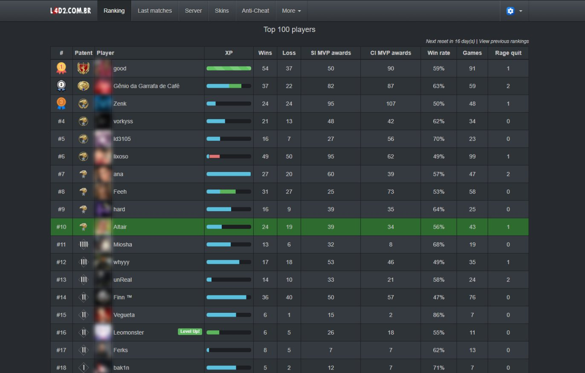
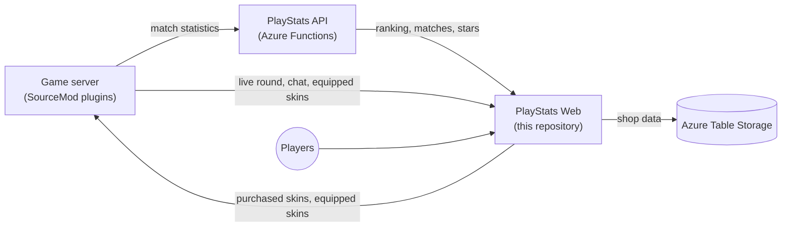
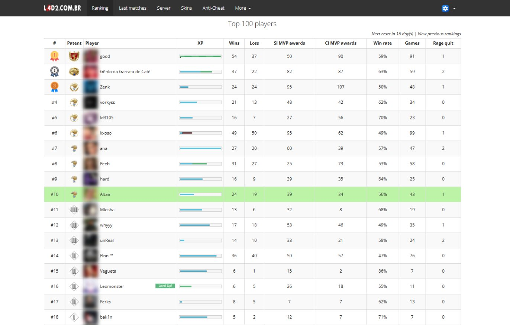
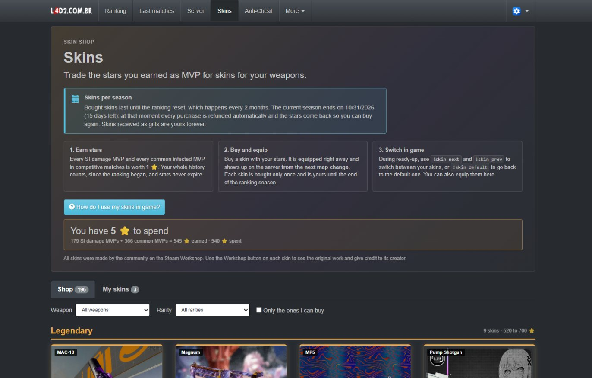
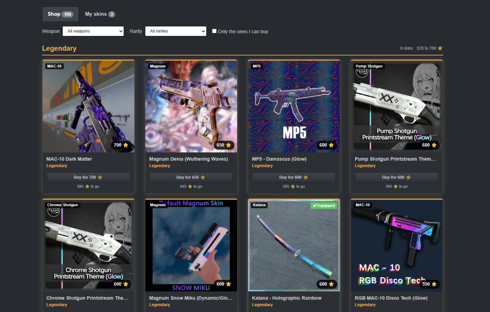
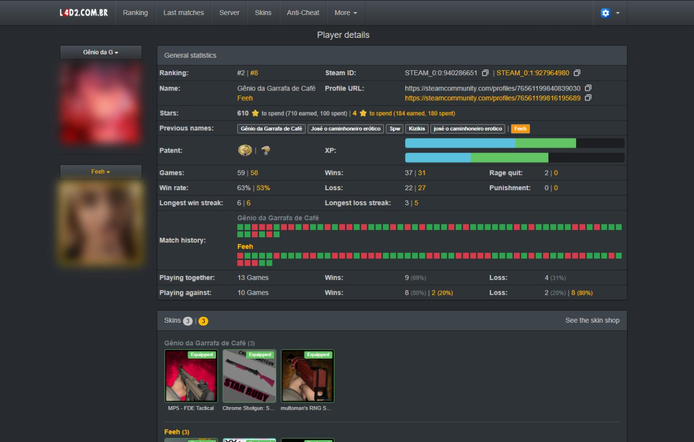
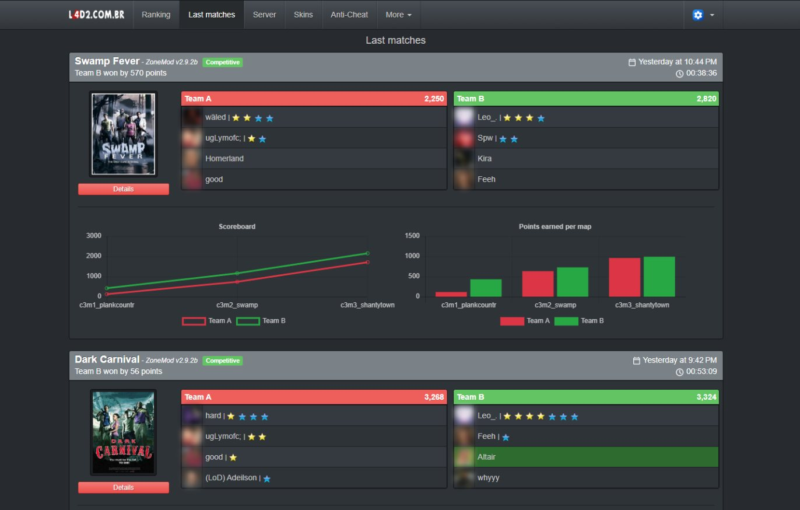
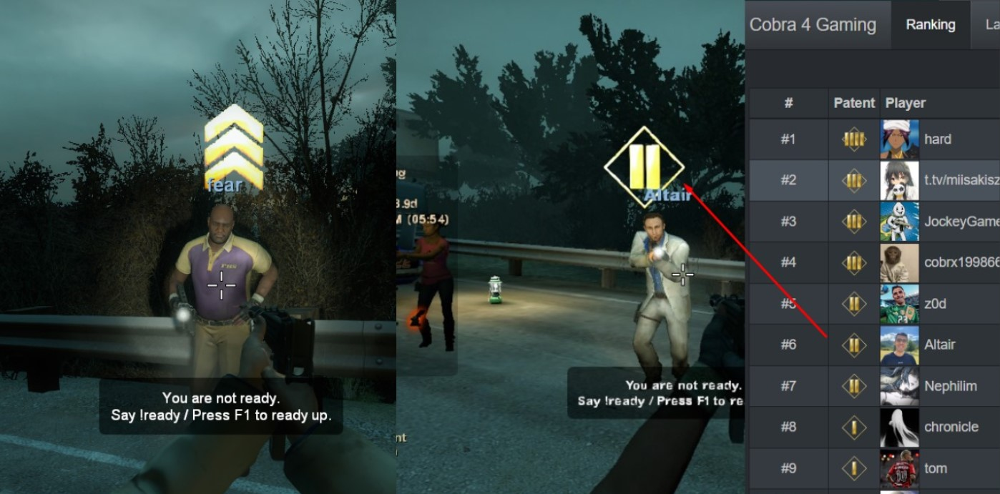

# L4D2 PlayStats Web

Ranking, statistics and weapon skin shop for a competitive Left 4 Dead 2 server. Built with ASP.NET Core MVC (.NET 10).

It runs the Brazilian community site **[l4d2.com.br](https://l4d2.com.br/)**.

<p align="center">
  
</p>

## Contents

- [Features](#features)
- [How it fits together](#how-it-fits-together)
- [Screenshots](#screenshots)
- [Requirements](#requirements)
- [Configuration](#configuration)
- [Game server plugins](#game-server-plugins)
- [Running locally](#running-locally)
- [Deployment](#deployment)
- [API used by the game server](#api-used-by-the-game-server)
- [Further documentation](#further-documentation)

## Features

**Ranking and statistics**

- Ranking built from the match statistics stored by the [PlayStats API](https://github.com/altair-sossai/l4d2-playstats-api). The ranking resets every two months, and previous rankings stay available on the history page.
- Patents (levels), each player's details page, and side-by-side comparison of two players, including their stars and skins.
- Latest matches with scores, per-map points, charts and match details.
- Server page with the live round: scoreboard, players and chat, sent by the game server in real time.

**Weapon skin shop**

- Players earn **1 star per MVP** (special infected damage or common infected) in competitive matches, counted over their whole history.
- Stars buy skins for 15 weapons: the SMG, MAC-10, MP5, pump shotgun, chrome shotgun, Magnum and 9 melee weapons.
- There are 196 community-made skins in five rarities. The catalog, prices and credits come from the Steam Workshop.
- Every skin has six in-game photos, taken with [l4d2-screenshot-studio](https://github.com/altair-sossai/l4d2-screenshot-studio): first person, three on the ground and two in third person. Hovering a card cycles through the first-person and third-person photos, and the details window shows all six with thumbnails and zoom. The photos are AVIF (WebP for older browsers), served from Azure Blob Storage and only downloaded when a player hovers a card or opens a skin. `shots` in `skins.json` is the photo version: raise it when a skin's photos are redone, so browsers fetch the new files.
- Bought skins last one ranking season. At every ranking reset, purchases are refunded automatically and the stars come back. Gifts are kept forever.
- Players equip skins on the site or in game with `!skin`. The game server downloads only the skins that someone bought.

**Administration** (only for the SteamIDs in `ServerAdmins`)

- Skin purchases: totals, search, refunds (one purchase or everything) and gifts.
- Skin prices: change a price without a deploy.
- Chat bans for the site chat.

**General**

- English, Portuguese (Brazil) and Spanish, with dark and light themes.
- Responsive layout. It also works in the game's built-in browser, which is why it uses Bootstrap 3.4.1 and jQuery 1.12.4.
- Steam sign-in (OpenID), and player names and avatars from the Steam Web API.
- An anti-cheat page for players.

## How it fits together



| Repository | Role |
|---|---|
| [l4d2-playstats-api](https://github.com/altair-sossai/l4d2-playstats-api) | Stores the statistics, builds matches and the ranking, and calculates the stars |
| [l4d2-zone-server](https://github.com/altair-sossai/l4d2-zone-server) | Game server configs and SourceMod plugins, including the full [weapon skins wiki](https://github.com/altair-sossai/l4d2-zone-server/tree/master/docs/weapon-skins) |
| [l4d2-zone-server-assets](https://github.com/altair-sossai/l4d2-zone-server-assets) | Skin models and materials (FastDL), with the [credits to every skin author](https://github.com/altair-sossai/l4d2-zone-server-assets#weapon-skin-credits) |

## Screenshots

### Ranking

Dark and light themes.

<p align="center">
  
</p>

<p align="center">
  
</p>

### Weapon skin shop

The season rule, how to earn and use stars, and the player's balance.

<p align="center">
  
</p>

The catalog, grouped by rarity, with filters by weapon and rarity.

<p align="center">
  
</p>

### Player comparison

Two players side by side: ranking, stars, statistics, match history and skins. The first player is shown in white and the second in yellow.

<p align="center">
  
</p>

### Last matches

<p align="center">
  
</p>

### Patent shown in game

<p align="center">
  
</p>

> Player avatars are blurred in these screenshots.

## Requirements

- **.NET 10 SDK** to build and run.
- **[PlayStats API](https://github.com/altair-sossai/l4d2-playstats-api)**: the site reads the ranking, matches and stars from it.
- **Azure Storage account** (or [Azurite](https://learn.microsoft.com/azure/storage/common/storage-use-azurite) locally). It holds the shop tables (`SkinShop`, `SkinPrices`), the chat bans and the live game info.
- **Steam Web API key**, created at [steamcommunity.com/dev/apikey](https://steamcommunity.com/dev/apikey). It is used for player names, avatars and the server details.

## Configuration

`L4D2PlayStats.Web/L4D2PlayStats.Web/appsettings.json` is ignored by git. Create it on the host with these keys. The values below are placeholders; never commit real values.

```json
{
  "ServerId": "",
  "PlayStatsApiUrl": "",
  "PlayStatsSecret": "",
  "SteamApiKey": "",
  "ServerDns": "",
  "ServerAdmins": "",
  "SecretKey": "",
  "AzureWebJobsStorage": ""
}
```

| Key | What it is |
|---|---|
| `ServerId` | The server id registered in the PlayStats API |
| `PlayStatsApiUrl` | Base URL of the PlayStats API |
| `PlayStatsSecret` | Secret used by the site's calls to the PlayStats API |
| `SteamApiKey` | Steam Web API key |
| `ServerDns` | Hostname players use to connect, e.g. `server.example.com` or `host:port`. It is shown as the `connect` command and resolved to the server address once per process (port 27015 by default) |
| `ServerAdmins` | SteamID64s of the site admins, separated by `;` |
| `SecretKey` | Shared secret that the game server sends in the `Authorization` header. It must match the plugins' `l4d2_web_secret` |
| `AzureWebJobsStorage` | Azure Storage connection string. Use `UseDevelopmentStorage=true` for Azurite |
| `SkinShotsUrl` | Optional. Base URL of the in-game skin photos. Defaults to `https://l4d2playstats.blob.core.windows.net/assets/skin-shots` |

## Game server plugins

All plugins live in [l4d2-zone-server](https://github.com/altair-sossai/l4d2-zone-server), where [docs/plugins](https://github.com/altair-sossai/l4d2-zone-server/blob/master/docs/plugins/README.md) documents each one.

| Plugin | What it does | Main settings |
|---|---|---|
| `l4d2_playstats` | Writes the statistics of each map | — |
| [`l4d2_playstats_sync`](https://github.com/altair-sossai/l4d2-zone-server/blob/master/addons/sourcemod/scripting/l4d2_playstats_sync.sp) | Uploads the statistics to the PlayStats API | `playstats_url`, `playstats_access_token` |
| [`l4d2_ranking`](https://github.com/altair-sossai/l4d2-zone-server/blob/master/addons/sourcemod/scripting/l4d2_ranking.sp) | `!ranking` and the ranking panel at the start of a game | `ranking_url` |
| [`l4d2_show_patent_icon`](https://github.com/altair-sossai/l4d2-zone-server/blob/master/addons/sourcemod/scripting/l4d2_show_patent_icon.sp) (optional) | Shows each player's patent above their head during ready-up | `patent_icon_api_url`, `patent_icon_version`, `patent_icon_max_level`, plus `sv_downloadurl` (FastDL) |
| [`l4d2_gameinfo_sync`](https://github.com/altair-sossai/l4d2-zone-server/blob/master/addons/sourcemod/scripting/l4d2_gameinfo_sync.sp) | Sends the live round, scoreboard and chat to the site | `l4d2_web_url`, `l4d2_web_secret` |
| [`l4d2_weapon_skins`](https://github.com/altair-sossai/l4d2-zone-server/blob/master/addons/sourcemod/scripting/l4d2_weapon_skins.sp) | Downloads the purchased skins, applies them and syncs the equipped skins | `l4d2_web_url`, `l4d2_web_secret` |

`l4d2_web_url` is the site URL, set in `server.cfg`. `l4d2_web_secret` is the same value as the site's `SecretKey`; keep it in a git-ignored config on the game server.

## Running locally

1. Start Azurite (`npm install -g azurite`, then `azurite`).
2. Create `appsettings.json` with `"AzureWebJobsStorage": "UseDevelopmentStorage=true"` and point `PlayStatsApiUrl` to a PlayStats API. Read-only use of a production API is fine; the shop data stays in Azurite.
3. Run the site:

```bash
dotnet run --project L4D2PlayStats.Web/L4D2PlayStats.Web
```

Sign in with Steam. Add your SteamID64 to `ServerAdmins` to see the Admin menu.

## Deployment

`azure-pipelines.yml` publishes a self-contained build on every push to `main`. It copies the build to the web host and restarts the site there. To publish by hand:

```bash
dotnet publish L4D2PlayStats.Web/L4D2PlayStats.Web/L4D2PlayStats.Web.csproj -c Release -o /path/to/output
```

## API used by the game server

| Method | Route | Used by |
|---|---|---|
| GET | `/api/skins` | `l4d2_weapon_skins`: skins bought by at least one player, which decides what gets downloaded |
| GET | `/api/players/skins` | `l4d2_weapon_skins`: owned and equipped skins of every player |
| GET | `/api/players/{communityId}/wallet` | `l4d2_weapon_skins` (`!skin status`): stars, spent and balance |
| POST | `/api/players/{communityId}/skins/equip` | `l4d2_weapon_skins`: saves a skin equipped in game (requires `Authorization: <SecretKey>`) |
| PUT/POST | `/api/game-info/*` | `l4d2_gameinfo_sync`: live round, scoreboard, players, chat and events (requires `Authorization: <SecretKey>`) |

## Further documentation

- [Weapon skins & skin shop wiki](https://github.com/altair-sossai/l4d2-zone-server/tree/master/docs/weapon-skins) covers how the skins are built, the plugin, the stars, the shop and operations, in English, Portuguese and Spanish.
- [Server documentation index](https://github.com/altair-sossai/l4d2-zone-server/blob/master/docs/README.md) has the player and admin guides, the plugins reference and tutorials.
