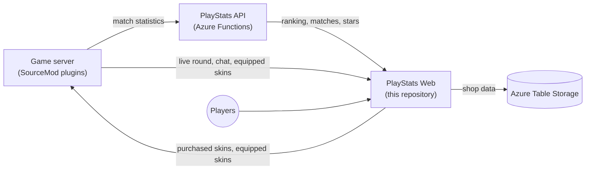

# L4D2 PlayStats Web

🌐 **English** | [Português](README.pt.md) | [Español](README.es.md)

Ranking, statistics and weapon skin shop for a competitive Left 4 Dead 2 server. Built with ASP.NET Core MVC (.NET 10).

It runs the Brazilian community site **[l4d2.com.br](https://l4d2.com.br/)**.

<p align="center">
  
</p>

## Contents

- [Features](#features)
- [How it fits together](#how-it-fits-together)
- [Screenshots](#screenshots)
- [Requirements](#requirements)
- [Configuration](#configuration)
- [Game server plugins](#game-server-plugins)
- [Running locally](#running-locally)
- [Deployment](#deployment)
- [API used by the game server](#api-used-by-the-game-server)
- [Checking that it works](#checking-that-it-works)
- [Troubleshooting](#troubleshooting)
- [Further documentation](#further-documentation)

## Features

**Ranking and statistics**

- Ranking built from the match statistics stored by the [PlayStats API](https://github.com/altair-sossai/l4d2-playstats-api). The ranking resets every two months, and previous rankings stay available on the history page.
- Patents (levels), each player's details page, and side-by-side comparison of two players, including their stars and skins.
- Latest matches with scores, per-map points, charts and match details.
- Server page with the live round: scoreboard, players and chat, sent by the game server in real time.

**Weapon skin shop**

- Players earn **1 star per MVP** (special infected damage or common infected) in competitive matches, counted over their whole history.
- Stars buy skins for 15 weapons: the SMG, MAC-10, MP5, pump shotgun, chrome shotgun, Magnum and 9 melee weapons.
- There are 196 community-made skins in five rarities. The catalog, prices and credits come from the Steam Workshop.
- Every skin has six in-game photos, taken with [l4d2-screenshot-studio](https://github.com/altair-sossai/l4d2-screenshot-studio): first person, three on the ground and two in third person. Hovering a card cycles through the first-person and third-person photos, and the details window shows all six with thumbnails and zoom. The photos are AVIF (WebP for older browsers), served from Azure Blob Storage and only downloaded when a player hovers a card or opens a skin. `shots` in `skins.json` is the photo version: raise it when a skin's photos are redone, so browsers fetch the new files.
- Bought skins last one ranking season. At every ranking reset, purchases are refunded automatically and the stars come back. Gifts are kept forever.
- Players equip skins on the site or in game with `!skin`. The game server downloads only the skins that someone bought.

**Administration** (only for the SteamIDs in `ServerAdmins`)

- Skin purchases: totals, search, refunds (one purchase or everything) and gifts.
- Skin prices: change a price without a deploy.
- Chat bans for the site chat.

**General**

- English, Portuguese (Brazil) and Spanish, with dark and light themes.
- Responsive layout. It also works in the game's built-in browser, which is why it uses Bootstrap 3.4.1 and jQuery 1.12.4.
- Steam sign-in (OpenID), and player names and avatars from the Steam Web API.
- An anti-cheat page for players.

## How it fits together



The site only reads from the PlayStats API, except for two admin actions (punishments and a match score fix), which need `PlayStatsSecret`. The live round, scoreboard, players and chat sent by the game server are kept in memory, so they are empty after a restart until the game server sends them again.

| Repository | Role |
|---|---|
| [l4d2-playstats-api](https://github.com/altair-sossai/l4d2-playstats-api) | Stores the statistics, builds matches and the ranking, and calculates the stars |
| [l4d2-zone-server](https://github.com/altair-sossai/l4d2-zone-server) | Game server configs and SourceMod plugins, including the full [weapon skins wiki](https://github.com/altair-sossai/l4d2-zone-server/tree/master/docs/weapon-skins) |
| [l4d2-zone-server-assets](https://github.com/altair-sossai/l4d2-zone-server-assets) | Skin models and materials (FastDL), with the [credits to every skin author](https://github.com/altair-sossai/l4d2-zone-server-assets#weapon-skin-credits) |

## Screenshots

### Ranking

Dark and light themes.

<p align="center">
  
</p>

<p align="center">
  
</p>

### Weapon skin shop

The season rule, how to earn and use stars, and the player's balance.

<p align="center">
  
</p>

The catalog, grouped by rarity, with filters by weapon and rarity.

<p align="center">
  
</p>

### Player comparison

Two players side by side: ranking, stars, statistics, match history and skins. The first player is shown in white and the second in yellow.

<p align="center">
  
</p>

### Last matches

<p align="center">
  
</p>

### Patent shown in game

<p align="center">
  
</p>

> Player avatars are blurred in these screenshots.

## Requirements

| What | Why |
|---|---|
| **.NET 10 SDK** | Build and run. The production build is self-contained, so the host itself does not need .NET |
| **[PlayStats API](https://github.com/altair-sossai/l4d2-playstats-api)** | The site reads the ranking, matches and stars from it. Use an existing deployment or host your own. The site needs a server registered there: `ServerId` is the row key of a row in the API's `Servers` table, and `PlayStatsSecret` is that row's `Secret` |
| **Azure Storage account** (or [Azurite](https://learn.microsoft.com/azure/storage/common/storage-use-azurite) locally) | Table storage only: `SkinShop` (purchases, wallets, equipped skins), `SkinPrices` (price overrides), `ChatBans` and `PlayerConnectionInfo`. The tables are created on first use |
| **Steam Web API key** | Player names, avatars and the server details from the Steam server list |
| **Node.js** (local only) | To install Azurite with npm |

### Steam sign-in and the Steam Web API key

- Sign-in uses Steam OpenID. It needs no key and no registration. The routes are `/login` and `/logout`, and the sign-in cookie lasts 30 days.
- The Steam Web API key is created at [steamcommunity.com/dev/apikey](https://steamcommunity.com/dev/apikey): sign in with Steam, enter your site's domain, accept the terms and copy the key.
- `SteamApiKey` accepts several keys separated by `;`, `,` or `|`. The site uses them in turns.

## Configuration

`L4D2PlayStats.Web/L4D2PlayStats.Web/appsettings.json` is ignored by git. Create it on each machine. The values below are placeholders; never commit real values.

```json
{
  "Logging": {
    "LogLevel": {
      "Default": "Information",
      "Microsoft.AspNetCore": "Warning"
    }
  },
  "Kestrel": {
    "Endpoints": {
      "Http": {
        "Url": "http://*:5000"
      }
    }
  },
  "ServerId": "<server-id>",
  "PlayStatsApiUrl": "https://<playstats-api-host>",
  "PlayStatsSecret": "<server-secret>",
  "SteamApiKey": "<steam-web-api-key>",
  "ServerDns": "<game-server-host>:27015",
  "ServerAdmins": "<steamid64>;<steamid64>",
  "SecretKey": "<long-random-string>",
  "AzureWebJobsStorage": "<storage-connection-string>",
  "AllowedHosts": "*"
}
```

| Key | Required | What it is |
|---|---|---|
| `ServerId` | Yes | The server id registered in the PlayStats API. Every ranking, match and star request uses it |
| `PlayStatsApiUrl` | Yes | Base URL of the PlayStats API, without `/api`. The site does not start without it |
| `PlayStatsSecret` | Only for admin actions | The server's secret in the PlayStats API. The site sends `Authorization: <ServerId>:<PlayStatsSecret>`. Reading needs no secret; only the punishments and the match score update need it |
| `SteamApiKey` | Yes | Steam Web API key, or several separated by `;`, `,` or `\|` |
| `ServerDns` | Yes | Hostname players use to connect, e.g. `server.example.com` or `host:port`. It is shown as the `connect` command, `/connect` redirects to `steam://connect/<ip>:<port>`, and it is resolved to the server address once per process (port 27015 by default). The server details come from the Steam server list, so the game server must be listed by Steam |
| `ServerAdmins` | Yes | SteamID64s of the site admins, separated by `;`, `,` or `\|`. It must not be empty: every page checks it for signed-in users |
| `SecretKey` | Yes, for the game server | Shared secret that the game server sends in the `Authorization` header, compared exactly. It must match the plugins' `l4d2_web_secret`. Use a long random string, e.g. from `openssl rand -hex 32` |
| `AzureWebJobsStorage` | Yes | Azure Storage connection string. Use `UseDevelopmentStorage=true` for Azurite |
| `SkinShotsUrl` | No | Base URL of the in-game skin photos. Defaults to `https://l4d2playstats.blob.core.windows.net/assets/skin-shots` |
| `Kestrel:Endpoints:Http:Url` | No | Address and port Kestrel listens on. Production uses `http://*:5000`. Without it, the site listens on `http://localhost:5000` |
| `AllowedHosts`, `Logging` | No | Standard ASP.NET Core settings |

Notes:

- The site does not start without `appsettings.json` in its working directory (the project folder for `dotnet run`, the app folder on the host). It is loaded last, so its values win over environment variables and command-line arguments.
- `SteamApiKey`, `ServerAdmins` and the resolved `ServerDns` are read once per process. Restart the site after changing them.
- `appsettings.json` is copied to the publish output when it exists. CI builds never have it, so a deploy never replaces the file on the host; a local `dotnet publish` does include yours.
- The skin catalog (`L4D2PlayStats.Core/Skins/Data/skins.json`) is embedded in the build, so a catalog change needs a new build and deploy. Each skin `id` must match a skin in the plugin's `addons/sourcemod/configs/weapon_skins.cfg` in l4d2-zone-server. Prices can be changed on the admin page without a deploy; they are stored in `SkinPrices`.
- Some values are constants in `L4D2PlayStats.Core/AppConsts.cs`: the site URL used in page metadata (`https://l4d2.com.br`), the default share image, the Steam Web API base URL and the anti-cheat page links. A copy on another domain changes them there.

## Game server plugins

All plugins live in [l4d2-zone-server](https://github.com/altair-sossai/l4d2-zone-server), where [docs/plugins](https://github.com/altair-sossai/l4d2-zone-server/blob/master/docs/plugins/README.md) documents each one.

| Plugin | What it does | Main settings |
|---|---|---|
| `l4d2_playstats` | Writes the statistics of each map | — |
| [`l4d2_playstats_sync`](https://github.com/altair-sossai/l4d2-zone-server/blob/master/addons/sourcemod/scripting/l4d2_playstats_sync.sp) | Uploads the statistics to the PlayStats API, then clears the site's ranking cache at `<ranking_url>/api/cache/clear` | `playstats_url`, `playstats_access_token`, `ranking_url` |
| [`l4d2_ranking`](https://github.com/altair-sossai/l4d2-zone-server/blob/master/addons/sourcemod/scripting/l4d2_ranking.sp) | `!ranking` and the ranking panel at the start of a game | `ranking_url`, `ranking_show_motd_panel` |
| [`l4d2_show_patent_icon`](https://github.com/altair-sossai/l4d2-zone-server/blob/master/addons/sourcemod/scripting/l4d2_show_patent_icon.sp) (optional) | Shows each player's patent above their head during ready-up | `patent_icon_api_url`, `patent_icon_version`, `patent_icon_max_level`, plus `sv_downloadurl` (FastDL) |
| [`l4d2_gameinfo_sync`](https://github.com/altair-sossai/l4d2-zone-server/blob/master/addons/sourcemod/scripting/l4d2_gameinfo_sync.sp) | Sends the live round, scoreboard and chat to the site, and shows the site chat in game | `l4d2_web_url`, `l4d2_web_secret` |
| [`l4d2_weapon_skins`](https://github.com/altair-sossai/l4d2-zone-server/blob/master/addons/sourcemod/scripting/l4d2_weapon_skins.sp) | Downloads the purchased skins, applies them and syncs the equipped skins | `weapon_skins_enabled`, `l4d2_web_url`, `l4d2_web_secret`, plus `sv_downloadurl` (FastDL) |

Where each setting goes in l4d2-zone-server:

| Setting | File | Value |
|---|---|---|
| `l4d2_web_url` | `cfg/server.cfg` | Site URL without a trailing slash, e.g. `https://example.com` |
| `l4d2_web_secret` | `cfg/server_secrets.cfg` (git-ignored, executed by `server.cfg`) | The site's `SecretKey` |
| `playstats_access_token` | `cfg/server_secrets.cfg` | `<ServerId>:<PlayStatsSecret>`, the same server as the site's settings |
| `sv_downloadurl` | `cfg/server.cfg` | FastDL URL serving [l4d2-zone-server-assets](https://github.com/altair-sossai/l4d2-zone-server-assets) |
| `playstats_url` | `cfg/cfgogl/<config>/shared_cvars.cfg` | PlayStats API base URL |
| `ranking_url` | `cfg/cfgogl/<config>/shared_cvars.cfg` | Site URL. It is shown in the ranking panel and used to clear the site cache |
| `patent_icon_api_url` | `cfg/cfgogl/<config>/shared_cvars.cfg` | Site URL |
| `weapon_skins_enabled` | `cfg/cfgogl/<config>/shared_cvars.cfg` | `1`. The plugin is off by default |

Every config in `cfg/cfgogl/` (e.g. `zonemod`, `neomod`) has its own `shared_cvars.cfg`, so set the values in each one you use.

## Running locally

1. Start Azurite (`npm install -g azurite`, then `azurite`). The tables are created on first use.
2. Create `L4D2PlayStats.Web/L4D2PlayStats.Web/appsettings.json` (see [Configuration](#configuration)) with:
   - `"AzureWebJobsStorage": "UseDevelopmentStorage=true"`;
   - `PlayStatsApiUrl` and `ServerId` pointing to a PlayStats API. Read-only use of a production API is fine: leave `PlayStatsSecret` empty and the API rejects any write;
   - your SteamID64 in `ServerAdmins`, a Steam Web API key and any local `SecretKey`;
   - no `Kestrel` section, so the site listens on `http://localhost:5000`.
3. Run the site:

```bash
dotnet run --project L4D2PlayStats.Web/L4D2PlayStats.Web
```

4. Open `http://localhost:5000` and sign in with Steam. With your SteamID64 in `ServerAdmins`, the Admin menu appears.

> Never point a local run at the production storage account. The season refund service runs every 10 minutes and writes to the shop tables, and every purchase, gift or price change is written there too.

To act as the game server, import `postman/L4D2.postman_collection.json` into Postman. Its `baseURL` is `http://localhost:5000`; replace the `Authorization` value `SecretKey` with your `SecretKey`.

## Deployment

The production site is a self-contained Linux x64 build in `/home/l4d2-playstats-web`, started inside a `screen` session named `l4d2-playstats-web`. Kestrel serves plain HTTP on port 5000. There is no systemd unit; an `@reboot` cron entry starts it after a reboot.

| Path on the host | Content |
|---|---|
| `/home/l4d2-playstats-web` | The build, `appsettings.json`, `logs/` and the player avatars downloaded at runtime (`wwwroot/imgs/players`) |
| `/home/l4d2-playstats-web/bash` | `bootstrap.sh`, which starts the site in `screen` with `sudo` |
| `/home/devops` | Staging folder for the pipeline's archives |

### Preparing a Linux VPS

These are the steps the repository's scripts expect, on Debian or Ubuntu. The [Ansible playbook](#ansible) does all of them.

1. Install the packages: `sudo apt-get install -y screen dos2unix libicu-dev ca-certificates rsync`.
2. Create a deploy user with SSH key access (the repository uses `devops`) and give it the app folder: `sudo mkdir -p /home/l4d2-playstats-web && sudo chown <deploy-user>: /home/l4d2-playstats-web`.
3. Write `/home/l4d2-playstats-web/appsettings.json` with the production values and the `Kestrel` section from [Configuration](#configuration). Restrict it with `chmod 640`.
4. Add the boot entry to the deploy user's crontab:

```bash
@reboot cd /home/l4d2-playstats-web && /usr/bin/screen -d -m -S l4d2-playstats-web sh -c './L4D2PlayStats.Web'
```

5. Open TCP port 5000 in the firewall, or only the port of your reverse proxy.
6. Deploy with one of the options below.

### Azure Pipelines

`azure-pipelines.yml` runs on every push to `main`:

| Stage | Steps |
|---|---|
| `BuildAndTest` | Installs the .NET 10 SDK, restores and builds in Release |
| `PublishAndDeploy` | Publishes a self-contained build on an Ubuntu agent, packs it and `bash/` into `publish.tar.gz` and `bash.tar.gz`, copies them to `/home/devops` over SSH and runs `scripts/deploy.sh` on the host |

It needs one SSH service connection named `L4D2 - Resources` (host, deploy user and private key) in the Azure DevOps project. There are no pipeline variables or secrets.

`scripts/deploy.sh` stops the `screen` session, extracts both archives into `/home/l4d2-playstats-web`, fixes line endings and permissions, starts a new `screen` session and deletes the archives.

### Ansible

[`ansible/`](ansible/README.md) provisions the VPS and deploys in one run: it installs the packages, optionally opens SSH and the web port with UFW (`manage_ufw`), creates the folders, publishes the project on the control node, ships it with rsync, renders `appsettings.json` from `group_vars/all.yml` and an Ansible Vault file, adds the `@reboot` entry and starts the site.

1. Install the collections: `ansible-galaxy collection install -r requirements.yml`.
2. Set your host and deploy user in `inventory.ini`.
3. Replace the values in `group_vars/all.yml` (`ServerId`, `PlayStatsApiUrl`, `ServerDns`, `ServerAdmins`, `http_port`, paths); they are the values of the l4d2.com.br site.
4. Copy `group_vars/vault.example.yml` to `group_vars/vault.yml`, fill in the secrets and run `ansible-vault encrypt group_vars/vault.yml`.
5. Run `ansible-playbook site.yml --ask-vault-pass` from the `ansible` folder.

The publish runs without a runtime identifier, so it targets the control node's platform. Run it from Linux x64 (or WSL), or publish with `-r linux-x64` yourself and pass `-e web_build_locally=false -e web_publish_dir=/path/to/publish`.

### By hand

Move your local `appsettings.json` out of the project first, or it is copied into the build.

```bash
dotnet publish L4D2PlayStats.Web/L4D2PlayStats.Web/L4D2PlayStats.Web.csproj -c Release --self-contained true -r linux-x64 -o ./publish
rsync -a ./publish/ <deploy-user>@<host>:/home/l4d2-playstats-web/
```

Then, on the host:

```bash
screen -S l4d2-playstats-web -X quit
cd /home/l4d2-playstats-web && chmod +x L4D2PlayStats.Web
screen -d -m -S l4d2-playstats-web sh -c 'cd /home/l4d2-playstats-web && ./L4D2PlayStats.Web'
```

`screen -r l4d2-playstats-web` attaches to the running site (`Ctrl+A`, `D` detaches).

### HTTPS

The repository has no reverse proxy or TLS configuration; Kestrel serves HTTP only. For HTTPS, put a reverse proxy or CDN in front that forwards to `http://127.0.0.1:5000`. The site does not enable forwarded headers, so it builds absolute addresses, such as the Steam sign-in return address, from the request the proxy sends. Keep the original `Host` header and test the Steam sign-in after setting it up.

## API used by the game server

"Secret" means `Authorization: <SecretKey>`; a missing or different value returns `401`.

| Method | Route | Auth | Used by |
|---|---|---|---|
| GET | `/api/skins` | — | `l4d2_weapon_skins`: skins bought by at least one player, which decides what gets downloaded |
| GET | `/api/players/skins` | — | `l4d2_weapon_skins`: owned and equipped skins of every player |
| GET | `/api/players/{communityId}/wallet` | — | `l4d2_weapon_skins` (`!skin status`): stars, spent and balance |
| POST | `/api/players/{communityId}/skins/equip` | Secret | `l4d2_weapon_skins`: saves a skin equipped in game |
| GET | `/api/players/patents` | — | `l4d2_show_patent_icon`: each player's patent |
| PUT | `/api/game-info/configuration`, `round`, `scoreboard`, `players`, `messages` | Secret | `l4d2_gameinfo_sync`: live round, scoreboard, players and chat |
| POST | `/api/game-info/events` | Secret | `l4d2_gameinfo_sync`: round events for the server page feed |
| POST | `/api/game-info/player-connection-info` | Secret | `l4d2_gameinfo_sync`: player connections, kept in `PlayerConnectionInfo` for three months |
| GET | `/api/game-info/server-command/dequeue` | Secret | `l4d2_gameinfo_sync`: next command sent by an admin from the site chat (`204` when there is none) |
| GET | `/api/external-chat` | — | `l4d2_gameinfo_sync`: site chat messages shown in game |
| POST | `/api/cache/clear` | — | `l4d2_playstats_sync`: clears the cached ranking and matches after an upload (otherwise they refresh within an hour) |

## Checking that it works

| Check | Expected |
|---|---|
| Open `/` | The current ranking. It needs `PlayStatsApiUrl` and `ServerId` |
| Open `/login` | Steam sign-in, then back to the site signed in. Admins see the Admin menu |
| Open `/skins` | The catalog; after signing in, the star balance. It needs the storage and the API |
| `curl -i -H "Authorization: <SecretKey>" http://<host>:5000/api/game-info/server-command/dequeue` | `204` with the right secret, `401` with a wrong one. If an admin command is pending, this takes it from the queue |
| Open `/server` while the game server is running | The live round, players and chat |
| In game, `!ranking` and `!skin` | The ranking panel and the skin menu |
| `logs/app<yyyyMMdd>.log` in the working directory | No errors at startup. One file per day, the last 5 kept |

## Troubleshooting

| Symptom | Cause and fix |
|---|---|
| The site exits at startup saying `appsettings.json` was not found | The file is missing from the working directory. The `screen` command must `cd` into the app folder |
| The site exits at startup with a URI error | `PlayStatsApiUrl` is missing or not a valid URL |
| Errors such as `ServerId is not configured`, `SteamApiKey is not configured` or `ServerAdmins is not configured` | Set the key in `appsettings.json` and restart |
| `AzureWebJobsStorage is not configured` or storage connection errors; shop and chat bans fail | Set the connection string. Locally, check that Azurite is running |
| The game server gets `401` | `l4d2_web_secret` differs from `SecretKey`. The comparison is exact, including spaces |
| No Admin menu | Your SteamID64 is not in `ServerAdmins`, or the site was not restarted after the change |
| Avatars do not show | Invalid `SteamApiKey`, or the site user cannot write to `wwwroot/imgs/players` |
| The server page has no server details | `ServerDns` is wrong or the server is not on the Steam server list. The address is resolved once per process; restart after the server's IP changes |
| The ranking takes up to an hour to update after a match | `ranking_url` does not reach the site, so `/api/cache/clear` is not called |
| Punishments or the match score update fail | `PlayStatsSecret` does not match the server's secret in the PlayStats API |
| `!skin status` reports the wallet as unavailable | The site could not read the stars from the PlayStats API (`503`) |

## Further documentation

- [Weapon skins & skin shop wiki](https://github.com/altair-sossai/l4d2-zone-server/tree/master/docs/weapon-skins) covers how the skins are built, the plugin, the stars, the shop and operations, in English, Portuguese and Spanish.
- [Server documentation index](https://github.com/altair-sossai/l4d2-zone-server/blob/master/docs/README.md) has the player and admin guides, the plugins reference and tutorials.
