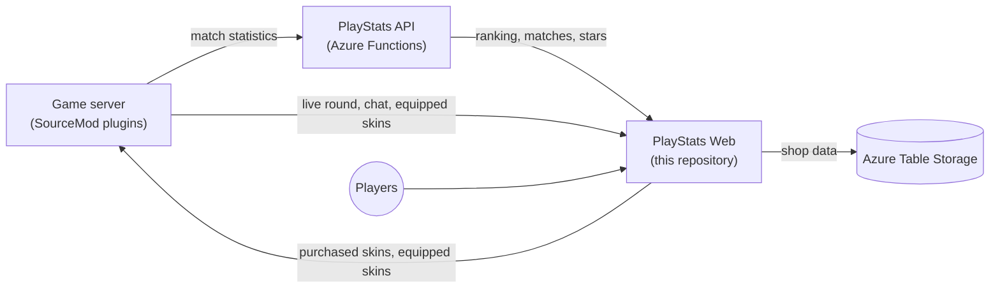

# L4D2 PlayStats Web

🌐 [English](README.md) | **Português** | [Español](README.es.md)

Ranking, estatísticas e loja de skins de armas para um servidor competitivo de Left 4 Dead 2. Feito com ASP.NET Core MVC (.NET 10).

É o site da comunidade brasileira **[l4d2.com.br](https://l4d2.com.br/)**.

<p align="center">
  
</p>

## Conteúdo

- [Recursos](#recursos)
- [Como as partes se conectam](#como-as-partes-se-conectam)
- [Capturas de tela](#capturas-de-tela)
- [Requisitos](#requisitos)
- [Configuração](#configuração)
- [Plugins do servidor de jogo](#plugins-do-servidor-de-jogo)
- [Executando localmente](#executando-localmente)
- [Implantação](#implantação)
- [API usada pelo servidor de jogo](#api-usada-pelo-servidor-de-jogo)
- [Verificando se funciona](#verificando-se-funciona)
- [Solução de problemas](#solução-de-problemas)
- [Documentação adicional](#documentação-adicional)

## Recursos

**Ranking e estatísticas**

- Ranking montado a partir das estatísticas das partidas guardadas pela [PlayStats API](https://github.com/altair-sossai/l4d2-playstats-api). O ranking reinicia a cada dois meses, e os rankings anteriores continuam disponíveis na página de histórico.
- Patentes (níveis), a página de detalhes de cada jogador e a comparação lado a lado de dois jogadores, incluindo estrelas e skins.
- Últimas partidas com placares, pontos por mapa, gráficos e detalhes da partida.
- Página do servidor com a rodada ao vivo: placar, jogadores e chat, enviados pelo servidor de jogo em tempo real.

**Loja de skins de armas**

- Os jogadores ganham **1 estrela por MVP** (dano em infectados especiais ou infectados comuns) em partidas competitivas, contadas em todo o histórico.
- As estrelas compram skins para 15 armas: SMG, MAC-10, MP5, pump shotgun, chrome shotgun, Magnum e 9 armas brancas.
- São 196 skins feitas pela comunidade, em cinco raridades. O catálogo, os preços e os créditos vêm da Steam Workshop.
- Cada skin tem seis fotos tiradas no jogo com o [l4d2-screenshot-studio](https://github.com/altair-sossai/l4d2-screenshot-studio): primeira pessoa, três no chão e duas em terceira pessoa. Passar o mouse sobre um card alterna entre as fotos em primeira e terceira pessoa, e a janela de detalhes mostra as seis com miniaturas e zoom. As fotos são AVIF (WebP para navegadores antigos), servidas pelo Azure Blob Storage e só baixadas quando o jogador passa o mouse sobre um card ou abre uma skin. `shots` no `skins.json` é a versão das fotos: aumente quando as fotos de uma skin forem refeitas, para que os navegadores baixem os arquivos novos.
- As skins compradas valem por uma temporada do ranking. A cada reinício do ranking, as compras são reembolsadas automaticamente e as estrelas voltam. Presentes ficam para sempre.
- Os jogadores equipam as skins no site ou no jogo com `!skin`. O servidor de jogo baixa apenas as skins que alguém comprou.

**Administração** (só para os SteamIDs em `ServerAdmins`)

- Compras de skins: totais, busca, reembolsos (uma compra ou todas) e presentes.
- Preços das skins: altere um preço sem deploy.
- Banimentos do chat do site.

**Geral**

- Inglês, português (Brasil) e espanhol, com temas escuro e claro.
- Layout responsivo. Também funciona no navegador embutido do jogo, por isso usa Bootstrap 3.4.1 e jQuery 1.12.4.
- Login com Steam (OpenID), e nomes e avatares dos jogadores pela Steam Web API.
- Uma página de anti-cheat para os jogadores.

## Como as partes se conectam



O site só lê da PlayStats API, exceto por duas ações de admin (punições e a correção do placar de uma partida), que precisam do `PlayStatsSecret`. A rodada ao vivo, o placar, os jogadores e o chat enviados pelo servidor de jogo ficam em memória, então ficam vazios depois de um reinício até o servidor de jogo enviá-los de novo.

| Repositório | Papel |
|---|---|
| [l4d2-playstats-api](https://github.com/altair-sossai/l4d2-playstats-api) | Guarda as estatísticas, monta as partidas e o ranking, e calcula as estrelas |
| [l4d2-zone-server](https://github.com/altair-sossai/l4d2-zone-server) | Configs do servidor de jogo e plugins SourceMod, incluindo a [wiki completa das skins de armas](https://github.com/altair-sossai/l4d2-zone-server/tree/master/docs/weapon-skins) |
| [l4d2-zone-server-assets](https://github.com/altair-sossai/l4d2-zone-server-assets) | Modelos e materiais das skins (FastDL), com os [créditos de cada autor de skin](https://github.com/altair-sossai/l4d2-zone-server-assets#weapon-skin-credits) |

## Capturas de tela

### Ranking

Temas escuro e claro.

<p align="center">
  
</p>

<p align="center">
  
</p>

### Loja de skins de armas

A regra da temporada, como ganhar e usar as estrelas, e o saldo do jogador.

<p align="center">
  
</p>

O catálogo, agrupado por raridade, com filtros por arma e raridade.

<p align="center">
  
</p>

### Comparação de jogadores

Dois jogadores lado a lado: ranking, estrelas, estatísticas, histórico de partidas e skins. O primeiro jogador aparece em branco e o segundo em amarelo.

<p align="center">
  
</p>

### Últimas partidas

<p align="center">
  
</p>

### Patente exibida no jogo

<p align="center">
  
</p>

> Os avatares dos jogadores estão desfocados nestas capturas.

## Requisitos

| O quê | Para quê |
|---|---|
| **.NET 10 SDK** | Compilar e executar. O build de produção é self-contained, então o host não precisa do .NET |
| **[PlayStats API](https://github.com/altair-sossai/l4d2-playstats-api)** | O site lê dela o ranking, as partidas e as estrelas. Use uma implantação existente ou hospede a sua. O site precisa de um servidor cadastrado lá: `ServerId` é a row key de uma linha da tabela `Servers` da API, e `PlayStatsSecret` é o `Secret` dessa linha |
| **Conta do Azure Storage** (ou [Azurite](https://learn.microsoft.com/azure/storage/common/storage-use-azurite) localmente) | Só Table Storage: `SkinShop` (compras, carteiras, skins equipadas), `SkinPrices` (preços alterados), `ChatBans` e `PlayerConnectionInfo`. As tabelas são criadas no primeiro uso |
| **Chave da Steam Web API** | Nomes e avatares dos jogadores e os detalhes do servidor pela lista de servidores da Steam |
| **Node.js** (só localmente) | Para instalar o Azurite com npm |

### Login com Steam e a chave da Steam Web API

- O login usa Steam OpenID. Não precisa de chave nem de cadastro. As rotas são `/login` e `/logout`, e o cookie de login dura 30 dias.
- A chave da Steam Web API é criada em [steamcommunity.com/dev/apikey](https://steamcommunity.com/dev/apikey): entre com a Steam, informe o domínio do seu site, aceite os termos e copie a chave.
- `SteamApiKey` aceita várias chaves separadas por `;`, `,` ou `|`. O site usa uma de cada vez, em rodízio.

## Configuração

`L4D2PlayStats.Web/L4D2PlayStats.Web/appsettings.json` é ignorado pelo git. Crie-o em cada máquina. Os valores abaixo são placeholders; nunca faça commit de valores reais.

```json
{
  "Logging": {
    "LogLevel": {
      "Default": "Information",
      "Microsoft.AspNetCore": "Warning"
    }
  },
  "Kestrel": {
    "Endpoints": {
      "Http": {
        "Url": "http://*:5000"
      }
    }
  },
  "ServerId": "<server-id>",
  "PlayStatsApiUrl": "https://<playstats-api-host>",
  "PlayStatsSecret": "<server-secret>",
  "SteamApiKey": "<steam-web-api-key>",
  "ServerDns": "<game-server-host>:27015",
  "ServerAdmins": "<steamid64>;<steamid64>",
  "SecretKey": "<long-random-string>",
  "AzureWebJobsStorage": "<storage-connection-string>",
  "AllowedHosts": "*"
}
```

| Chave | Obrigatória | O que é |
|---|---|---|
| `ServerId` | Sim | O id do servidor cadastrado na PlayStats API. Toda requisição de ranking, partidas e estrelas usa esse valor |
| `PlayStatsApiUrl` | Sim | URL base da PlayStats API, sem `/api`. O site não inicia sem ela |
| `PlayStatsSecret` | Só para ações de admin | O secret do servidor na PlayStats API. O site envia `Authorization: <ServerId>:<PlayStatsSecret>`. Leitura não precisa de secret; só as punições e a atualização do placar de uma partida precisam |
| `SteamApiKey` | Sim | Chave da Steam Web API, ou várias separadas por `;`, `,` ou `\|` |
| `ServerDns` | Sim | Hostname que os jogadores usam para conectar, por exemplo `server.example.com` ou `host:porta`. Aparece como o comando `connect`, `/connect` redireciona para `steam://connect/<ip>:<porta>`, e é resolvido para o endereço do servidor uma vez por processo (porta 27015 por padrão). Os detalhes do servidor vêm da lista de servidores da Steam, então o servidor de jogo precisa estar listado pela Steam |
| `ServerAdmins` | Sim | SteamID64s dos admins do site, separados por `;`, `,` ou `\|`. Não pode ficar vazio: toda página verifica esse valor para usuários logados |
| `SecretKey` | Sim, para o servidor de jogo | Secret compartilhado que o servidor de jogo envia no header `Authorization`, comparado de forma exata. Precisa ser igual ao `l4d2_web_secret` dos plugins. Use uma string longa e aleatória, por exemplo de `openssl rand -hex 32` |
| `AzureWebJobsStorage` | Sim | Connection string do Azure Storage. Use `UseDevelopmentStorage=true` para o Azurite |
| `SkinShotsUrl` | Não | URL base das fotos das skins no jogo. O padrão é `https://l4d2playstats.blob.core.windows.net/assets/skin-shots` |
| `Kestrel:Endpoints:Http:Url` | Não | Endereço e porta em que o Kestrel escuta. A produção usa `http://*:5000`. Sem ela, o site escuta em `http://localhost:5000` |
| `AllowedHosts`, `Logging` | Não | Configurações padrão do ASP.NET Core |

Observações:

- O site não inicia sem o `appsettings.json` no diretório de trabalho (a pasta do projeto no `dotnet run`, a pasta do app no host). Ele é carregado por último, então seus valores vencem as variáveis de ambiente e os argumentos de linha de comando.
- `SteamApiKey`, `ServerAdmins` e o `ServerDns` resolvido são lidos uma vez por processo. Reinicie o site depois de alterá-los.
- O `appsettings.json` é copiado para a saída do publish quando existe. Os builds de CI nunca o têm, então um deploy nunca substitui o arquivo no host; um `dotnet publish` local inclui o seu.
- O catálogo de skins (`L4D2PlayStats.Core/Skins/Data/skins.json`) é embutido no build, então uma mudança no catálogo precisa de um novo build e deploy. O `id` de cada skin precisa corresponder a uma skin no `addons/sourcemod/configs/weapon_skins.cfg` do plugin, no l4d2-zone-server. Os preços podem ser alterados na página de admin sem deploy; eles ficam em `SkinPrices`.
- Alguns valores são constantes em `L4D2PlayStats.Core/AppConsts.cs`: a URL do site usada nos metadados das páginas (`https://l4d2.com.br`), a imagem padrão de compartilhamento, a URL base da Steam Web API e os links da página de anti-cheat. Uma cópia em outro domínio os altera ali.

## Plugins do servidor de jogo

Todos os plugins ficam no [l4d2-zone-server](https://github.com/altair-sossai/l4d2-zone-server), onde o [docs/plugins](https://github.com/altair-sossai/l4d2-zone-server/blob/master/docs/plugins/README.md) documenta cada um.

| Plugin | O que faz | Principais configurações |
|---|---|---|
| `l4d2_playstats` | Grava as estatísticas de cada mapa | — |
| [`l4d2_playstats_sync`](https://github.com/altair-sossai/l4d2-zone-server/blob/master/addons/sourcemod/scripting/l4d2_playstats_sync.sp) | Envia as estatísticas para a PlayStats API e depois limpa o cache do ranking do site em `<ranking_url>/api/cache/clear` | `playstats_url`, `playstats_access_token`, `ranking_url` |
| [`l4d2_ranking`](https://github.com/altair-sossai/l4d2-zone-server/blob/master/addons/sourcemod/scripting/l4d2_ranking.sp) | `!ranking` e o painel do ranking no início de um jogo | `ranking_url`, `ranking_show_motd_panel` |
| [`l4d2_show_patent_icon`](https://github.com/altair-sossai/l4d2-zone-server/blob/master/addons/sourcemod/scripting/l4d2_show_patent_icon.sp) (opcional) | Mostra a patente de cada jogador acima da cabeça durante o ready-up | `patent_icon_api_url`, `patent_icon_version`, `patent_icon_max_level`, além de `sv_downloadurl` (FastDL) |
| [`l4d2_gameinfo_sync`](https://github.com/altair-sossai/l4d2-zone-server/blob/master/addons/sourcemod/scripting/l4d2_gameinfo_sync.sp) | Envia a rodada ao vivo, o placar e o chat para o site, e mostra o chat do site no jogo | `l4d2_web_url`, `l4d2_web_secret` |
| [`l4d2_weapon_skins`](https://github.com/altair-sossai/l4d2-zone-server/blob/master/addons/sourcemod/scripting/l4d2_weapon_skins.sp) | Baixa as skins compradas, aplica-as e sincroniza as skins equipadas | `weapon_skins_enabled`, `l4d2_web_url`, `l4d2_web_secret`, além de `sv_downloadurl` (FastDL) |

Onde fica cada configuração no l4d2-zone-server:

| Configuração | Arquivo | Valor |
|---|---|---|
| `l4d2_web_url` | `cfg/server.cfg` | URL do site sem barra no final, por exemplo `https://example.com` |
| `l4d2_web_secret` | `cfg/server_secrets.cfg` (ignorado pelo git, executado pelo `server.cfg`) | O `SecretKey` do site |
| `playstats_access_token` | `cfg/server_secrets.cfg` | `<ServerId>:<PlayStatsSecret>`, o mesmo servidor das configurações do site |
| `sv_downloadurl` | `cfg/server.cfg` | URL do FastDL que serve o [l4d2-zone-server-assets](https://github.com/altair-sossai/l4d2-zone-server-assets) |
| `playstats_url` | `cfg/cfgogl/<config>/shared_cvars.cfg` | URL base da PlayStats API |
| `ranking_url` | `cfg/cfgogl/<config>/shared_cvars.cfg` | URL do site. Aparece no painel do ranking e é usada para limpar o cache do site |
| `patent_icon_api_url` | `cfg/cfgogl/<config>/shared_cvars.cfg` | URL do site |
| `weapon_skins_enabled` | `cfg/cfgogl/<config>/shared_cvars.cfg` | `1`. O plugin vem desligado por padrão |

Cada config em `cfg/cfgogl/` (por exemplo `zonemod`, `neomod`) tem seu próprio `shared_cvars.cfg`, então defina os valores em cada uma que você usar.

## Executando localmente

1. Inicie o Azurite (`npm install -g azurite`, depois `azurite`). As tabelas são criadas no primeiro uso.
2. Crie o `L4D2PlayStats.Web/L4D2PlayStats.Web/appsettings.json` (veja [Configuração](#configuração)) com:
   - `"AzureWebJobsStorage": "UseDevelopmentStorage=true"`;
   - `PlayStatsApiUrl` e `ServerId` apontando para uma PlayStats API. Usar uma API de produção só para leitura não tem problema: deixe o `PlayStatsSecret` vazio e a API rejeita qualquer escrita;
   - seu SteamID64 em `ServerAdmins`, uma chave da Steam Web API e qualquer `SecretKey` local;
   - sem a seção `Kestrel`, para o site escutar em `http://localhost:5000`.
3. Execute o site:

```bash
dotnet run --project L4D2PlayStats.Web/L4D2PlayStats.Web
```

4. Abra `http://localhost:5000` e entre com a Steam. Com seu SteamID64 em `ServerAdmins`, o menu Admin aparece.

> Nunca aponte uma execução local para a conta de storage de produção. O serviço de reembolso da temporada roda a cada 10 minutos e grava nas tabelas da loja, e toda compra, presente ou mudança de preço também é gravada lá.

Para fazer o papel do servidor de jogo, importe `postman/L4D2.postman_collection.json` no Postman. O `baseURL` dele é `http://localhost:5000`; troque o valor `SecretKey` do header `Authorization` pelo seu `SecretKey`.

## Implantação

O site de produção é um build self-contained para Linux x64 em `/home/l4d2-playstats-web`, iniciado dentro de uma sessão `screen` chamada `l4d2-playstats-web`. O Kestrel serve HTTP puro na porta 5000. Não há unit do systemd; uma entrada `@reboot` no cron inicia o site depois de um reboot.

| Caminho no host | Conteúdo |
|---|---|
| `/home/l4d2-playstats-web` | O build, o `appsettings.json`, `logs/` e os avatares dos jogadores baixados em tempo de execução (`wwwroot/imgs/players`) |
| `/home/l4d2-playstats-web/bash` | `bootstrap.sh`, que inicia o site no `screen` com `sudo` |
| `/home/devops` | Pasta de staging dos arquivos do pipeline |

### Preparando uma VPS Linux

Estes são os passos que os scripts do repositório esperam, em Debian ou Ubuntu. O [playbook do Ansible](#ansible) faz todos eles.

1. Instale os pacotes: `sudo apt-get install -y screen dos2unix libicu-dev ca-certificates rsync`.
2. Crie um usuário de deploy com acesso por chave SSH (o repositório usa `devops`) e dê a ele a pasta do app: `sudo mkdir -p /home/l4d2-playstats-web && sudo chown <deploy-user>: /home/l4d2-playstats-web`.
3. Escreva o `/home/l4d2-playstats-web/appsettings.json` com os valores de produção e a seção `Kestrel` de [Configuração](#configuração). Restrinja-o com `chmod 640`.
4. Adicione a entrada de boot ao crontab do usuário de deploy:

```bash
@reboot cd /home/l4d2-playstats-web && /usr/bin/screen -d -m -S l4d2-playstats-web sh -c './L4D2PlayStats.Web'
```

5. Abra a porta TCP 5000 no firewall, ou só a porta do seu proxy reverso.
6. Faça o deploy com uma das opções abaixo.

### Azure Pipelines

O `azure-pipelines.yml` roda a cada push na `main`:

| Stage | Passos |
|---|---|
| `BuildAndTest` | Instala o .NET 10 SDK, faz restore e build em Release |
| `PublishAndDeploy` | Publica um build self-contained em um agente Ubuntu, empacota-o junto com `bash/` em `publish.tar.gz` e `bash.tar.gz`, copia-os para `/home/devops` por SSH e executa `scripts/deploy.sh` no host |

Ele precisa de uma service connection SSH chamada `L4D2 - Resources` (host, usuário de deploy e chave privada) no projeto do Azure DevOps. Não há variáveis nem secrets no pipeline.

O `scripts/deploy.sh` para a sessão `screen`, extrai os dois arquivos em `/home/l4d2-playstats-web`, corrige as quebras de linha e as permissões, inicia uma nova sessão `screen` e apaga os arquivos.

### Ansible

O [`ansible/`](ansible/README.md) provisiona a VPS e faz o deploy em uma única execução: instala os pacotes, opcionalmente libera SSH e a porta web no UFW (`manage_ufw`), cria as pastas, publica o projeto no control node, envia-o com rsync, gera o `appsettings.json` a partir do `group_vars/all.yml` e de um arquivo do Ansible Vault, adiciona a entrada `@reboot` e inicia o site.

1. Instale as collections: `ansible-galaxy collection install -r requirements.yml`.
2. Defina seu host e usuário de deploy no `inventory.ini`.
3. Troque os valores em `group_vars/all.yml` (`ServerId`, `PlayStatsApiUrl`, `ServerDns`, `ServerAdmins`, `http_port`, caminhos); eles são os valores do site l4d2.com.br.
4. Copie `group_vars/vault.example.yml` para `group_vars/vault.yml`, preencha os secrets e execute `ansible-vault encrypt group_vars/vault.yml`.
5. Execute `ansible-playbook site.yml --ask-vault-pass` a partir da pasta `ansible`.

O publish roda sem runtime identifier, então gera o build para a plataforma do control node. Execute-o a partir de Linux x64 (ou WSL), ou publique você mesmo com `-r linux-x64` e passe `-e web_build_locally=false -e web_publish_dir=/path/to/publish`.

### Manualmente

Tire antes o seu `appsettings.json` local do projeto, ou ele é copiado para o build.

```bash
dotnet publish L4D2PlayStats.Web/L4D2PlayStats.Web/L4D2PlayStats.Web.csproj -c Release --self-contained true -r linux-x64 -o ./publish
rsync -a ./publish/ <deploy-user>@<host>:/home/l4d2-playstats-web/
```

Depois, no host:

```bash
screen -S l4d2-playstats-web -X quit
cd /home/l4d2-playstats-web && chmod +x L4D2PlayStats.Web
screen -d -m -S l4d2-playstats-web sh -c 'cd /home/l4d2-playstats-web && ./L4D2PlayStats.Web'
```

`screen -r l4d2-playstats-web` conecta ao site em execução (`Ctrl+A`, `D` desconecta).

### HTTPS

O repositório não tem configuração de proxy reverso nem de TLS; o Kestrel serve só HTTP. Para HTTPS, coloque na frente um proxy reverso ou CDN que encaminhe para `http://127.0.0.1:5000`. O site não habilita forwarded headers, então monta os endereços absolutos, como o endereço de retorno do login da Steam, a partir da requisição que o proxy envia. Mantenha o header `Host` original e teste o login da Steam depois de configurar.

## API usada pelo servidor de jogo

"Secret" significa `Authorization: <SecretKey>`; um valor ausente ou diferente retorna `401`.

| Método | Rota | Auth | Usada por |
|---|---|---|---|
| GET | `/api/skins` | — | `l4d2_weapon_skins`: skins compradas por pelo menos um jogador, o que decide o que é baixado |
| GET | `/api/players/skins` | — | `l4d2_weapon_skins`: skins possuídas e equipadas de todos os jogadores |
| GET | `/api/players/{communityId}/wallet` | — | `l4d2_weapon_skins` (`!skin status`): estrelas, gasto e saldo |
| POST | `/api/players/{communityId}/skins/equip` | Secret | `l4d2_weapon_skins`: salva uma skin equipada no jogo |
| GET | `/api/players/patents` | — | `l4d2_show_patent_icon`: a patente de cada jogador |
| PUT | `/api/game-info/configuration`, `round`, `scoreboard`, `players`, `messages` | Secret | `l4d2_gameinfo_sync`: rodada ao vivo, placar, jogadores e chat |
| POST | `/api/game-info/events` | Secret | `l4d2_gameinfo_sync`: eventos da rodada para o feed da página do servidor |
| POST | `/api/game-info/player-connection-info` | Secret | `l4d2_gameinfo_sync`: conexões dos jogadores, guardadas em `PlayerConnectionInfo` por três meses |
| GET | `/api/game-info/server-command/dequeue` | Secret | `l4d2_gameinfo_sync`: próximo comando enviado por um admin pelo chat do site (`204` quando não há nenhum) |
| GET | `/api/external-chat` | — | `l4d2_gameinfo_sync`: mensagens do chat do site exibidas no jogo |
| POST | `/api/cache/clear` | — | `l4d2_playstats_sync`: limpa o cache do ranking e das partidas depois de um envio (senão eles atualizam em até uma hora) |

## Verificando se funciona

| Verificação | Esperado |
|---|---|
| Abra `/` | O ranking atual. Precisa de `PlayStatsApiUrl` e `ServerId` |
| Abra `/login` | Login da Steam e volta ao site logado. Admins veem o menu Admin |
| Abra `/skins` | O catálogo; depois do login, o saldo de estrelas. Precisa do storage e da API |
| `curl -i -H "Authorization: <SecretKey>" http://<host>:5000/api/game-info/server-command/dequeue` | `204` com o secret certo, `401` com um errado. Se houver um comando de admin pendente, esta chamada o tira da fila |
| Abra `/server` com o servidor de jogo rodando | A rodada ao vivo, os jogadores e o chat |
| No jogo, `!ranking` e `!skin` | O painel do ranking e o menu de skins |
| `logs/app<yyyyMMdd>.log` no diretório de trabalho | Nenhum erro na inicialização. Um arquivo por dia, os 5 últimos são mantidos |

## Solução de problemas

| Sintoma | Causa e solução |
|---|---|
| O site fecha ao iniciar dizendo que o `appsettings.json` não foi encontrado | O arquivo não está no diretório de trabalho. O comando do `screen` precisa fazer `cd` para a pasta do app |
| O site fecha ao iniciar com um erro de URI | `PlayStatsApiUrl` está ausente ou não é uma URL válida |
| Erros como `ServerId is not configured`, `SteamApiKey is not configured` ou `ServerAdmins is not configured` | Defina a chave no `appsettings.json` e reinicie |
| `AzureWebJobsStorage is not configured` ou erros de conexão com o storage; a loja e os banimentos do chat falham | Defina a connection string. Localmente, verifique se o Azurite está rodando |
| O servidor de jogo recebe `401` | `l4d2_web_secret` é diferente do `SecretKey`. A comparação é exata, incluindo espaços |
| O menu Admin não aparece | Seu SteamID64 não está em `ServerAdmins`, ou o site não foi reiniciado depois da mudança |
| Os avatares não aparecem | `SteamApiKey` inválida, ou o usuário do site não consegue gravar em `wwwroot/imgs/players` |
| A página do servidor não mostra os detalhes do servidor | `ServerDns` está errado ou o servidor não está na lista de servidores da Steam. O endereço é resolvido uma vez por processo; reinicie depois que o IP do servidor mudar |
| O ranking demora até uma hora para atualizar depois de uma partida | `ranking_url` não chega ao site, então `/api/cache/clear` não é chamado |
| As punições ou a atualização do placar de uma partida falham | `PlayStatsSecret` não é igual ao secret do servidor na PlayStats API |
| `!skin status` diz que a carteira está indisponível | O site não conseguiu ler as estrelas da PlayStats API (`503`) |

## Documentação adicional

- A [wiki das skins de armas e da loja de skins](https://github.com/altair-sossai/l4d2-zone-server/tree/master/docs/weapon-skins) explica como as skins são feitas, o plugin, as estrelas, a loja e a operação, em inglês, português e espanhol.
- O [índice da documentação do servidor](https://github.com/altair-sossai/l4d2-zone-server/blob/master/docs/README.md) tem os guias para jogadores e admins, a referência dos plugins e os tutoriais.
